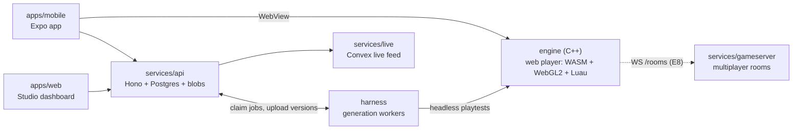

# Dreamsy

An AI-native game platform: describe a game (text + reference images) on iPhone or the web, and Dreamsy builds it, hosts it, and lets others play, remix, and share it, single or multiplayer. Think Roblox where the studio is an agent harness.

[DREAMSY.MD](DREAMSY.MD) is the source of truth for architecture and decisions. [STATUS.md](STATUS.md) tracks what's built, what's next, and production notes.

## How it fits together



Everything speaks one contract: the **game package** defined in `format/` (DREAMSY.MD §3). The harness writes packages, the API validates and versions them, and the C++ engine runs them in the browser, the app's WebView, natively, and in headless playtests.

## Repository layout

| Path | Package | What |
|---|---|---|
| `format/` | `@dreamsy/format` | Game package spec: schemas, entity catalog, styles, validator, edit ops, CLI. [LUAU_API.md](format/LUAU_API.md) is the scripting contract. |
| `engine/` | | The engine: C++20, 2D and 2.5D, one core for web (WASM), iOS, Android and headless tools. See [engine/README.md](engine/README.md). |
| `kits/` | | 21 genre kits: Luau libraries games load with `require("@kit/...")`, plus their docs and schemas. |
| `services/api/` | `@dreamsy/api` | Platform API: auth, games/versions, generation jobs, feed, remix, Stars store, leaderboards, groups. |
| `services/gameserver/` | `@dreamsy/gameserver` | Multiplayer room server: invite codes, 1v1 quick match, relay (DREAMSY.MD §4.5). |
| `services/live/` | `@dreamsy/live` | Convex functions for the live build feed. |
| `harness/` | `@dreamsy/harness` | Generation workers: router, director + content fan-out, playtest and art-director review. Claude or OpenAI builders. See [DESIGN.md](harness/DESIGN.md). |
| `apps/mobile/` | `@dreamsy/mobile` | iOS-first Expo app: feed, play, create, remix, profiles, market. |
| `apps/web/` | `@dreamsy/web` | Dreamsy Studio: build and edit games by chat in the browser, watch builds live, publish. |
| `games/examples/` | | Hand-written golden packages, including a minimal example per kit. |
| `games/showcase/` | | Generated showcase games seeded into the API. |
| `taste/` | | House-style packs (`packs/*.md`) and their reference images. |
| `deploy/` | | Production Docker Compose, Dockerfile, Caddyfile. |
| `scripts/` | | `dev.sh` (local stack, builds and serves the C++ web player). |
| `third_party/` | | Vendored libraries (Luau, Box2D, sokol, ...). Don't modify. |

## Prerequisites

- Node + pnpm (`packageManager: pnpm@10.4.1`), then `pnpm install` at the repo root.
- Docker Desktop (Postgres + MinIO for the API).
- An Expo account and Expo Go on the phone, signed in to the same account.
- Optional: `cloudflared` for `dev.sh --tunnel`.

## Environment

Real env files are gitignored; only `.env.example` templates are committed.

- **Repo-root `.env`**: model keys for the harness (`ANTHROPIC_API_KEY`, optional `GEMINI_API_KEY`; without Gemini, image generation is off) and `EXPO_TOKEN` for `dev.sh`.
- **`services/api/.env`**: `cp services/api/.env.example services/api/.env`, then set `JWT_SECRET` (32+ chars) and `WORKER_TOKEN` (shared with the harness worker and seed script).
- **`apps/mobile/.env.local`**: `EXPO_PUBLIC_API_URL` and `EXPO_PUBLIC_ENGINE_URL`. `dev.sh` writes this for you.
- **`apps/web/.env.local`**: `cp apps/web/.env.example apps/web/.env.local`. Without it the dashboard offers guest sign-in only.

## Quick start

Start Docker Desktop, then:

```sh
./scripts/dev.sh             # app points at prod (api.dreamsy.dev, play.dreamsy.dev)
./scripts/dev.sh --local     # app points at this laptop's API + engine
./scripts/dev.sh --tunnel    # phone on any network (Cloudflare quick tunnels; URLs are public while it runs)
./scripts/dev.sh --reseed    # publish the showcase games again
```

It runs Postgres, migrations, the API (`:8787`), the room server (`:8790`), seeds the showcase games once, starts a harness worker, the web dashboard (`:3000`), and the engine (`:2005`), then opens Expo Go. Scan the QR code with the iPhone camera and pick "Continue as guest". Logs go to `.dev-logs/`; Ctrl+C stops everything.

Fresh database: `docker compose -f services/api/docker-compose.yml down -v && rm -f .dev-logs/.seeded`.

### Manual steps

What `dev.sh` does, one terminal each from the repo root. Find the Mac's LAN IP with `ipconfig getifaddr en0`.

```sh
# 1. postgres + minio
docker compose -f services/api/docker-compose.yml up -d

# 2. migrate + run the API (binds 0.0.0.0:8787)
pnpm -C services/api db:migrate
pnpm -C services/api dev

# 3. room server (ws://<ip>:8790/rooms)
API_URL=http://localhost:8787 pnpm -C services/gameserver start

# 4. once: publish games/showcase + games/examples so Discover isn't empty
pnpm -C services/api seed:showcase

# 5. harness worker (builds games)
pnpm -C harness worker

# 6. the C++ web player the app's WebView loads (0.0.0.0:2005; needs emsdk 4.0.11, engine/README.md) and the web dashboard (:3000)
(cd engine && cmake --preset web && cmake --build --preset web --target dreamsy-player && cp build/web/dreamsy-player.html build/web/index.html)
python3 -m http.server 2005 --directory engine/build/web
pnpm -C apps/web dev

# 7. app in Expo Go (plain `expo start` targets a dev build)
cd apps/mobile && npx expo start --go
```

Apple and Google sign-in need a development build (`pnpm -C apps/mobile ios`), not Expo Go. If the phone can't reach `http://<ip>:8787/health` or `http://<ip>:2005/` in Safari, allow incoming connections for node in the macOS firewall.

On networks with broken IPv6 (VPNs, venue Wi-Fi), Node needs `NODE_OPTIONS=--network-family-autoselection-attempt-timeout=2000`; `dev.sh` sets it.

## Common tasks

```sh
pnpm test                                    # every package's tests
pnpm typecheck                               # every package's typecheck

pnpm -C harness local --prompt "a pixel game where a frog collects coins" --out /tmp/frog [--rounds N]
pnpm -C harness local --prompt "make the frog faster" --base /tmp/frog --select player --out /tmp/frog2
pnpm -C format cli validate /tmp/frog        # validate a game package
pnpm -C format catalog                       # regenerate format/catalog.json
engine/build/release/dreamsy-tool playtest /tmp/frog   # headless playtest report (JSON); build: engine/README.md

pnpm -C services/api db:generate             # after editing services/api/src/db/schema.ts; commit the migration
```

API tests run on PGlite with in-memory storage, so they don't need Docker.

## Production

Prod is down (torn down 2026-11-16, STATUS.md) and there is no deploy script; `deploy/` keeps the stack for the next host.
One box behind Caddy, mirroring the dev stack via `deploy/docker-compose.yml` (Postgres, API, Claude and OpenAI harness workers, room server, Caddy). Secrets live in `deploy/.env.prod` (gitignored).

| Host | Serves |
|---|---|
| `api.dreamsy.dev` | API; `/rooms*` routes to the room server |
| `play.dreamsy.dev` | C++ web player (built in `deploy/Dockerfile`, published by the compose `player` service) |
| `dreamsy.dev` | Web dashboard (static `apps/web` build) |

```sh
docker compose -f deploy/docker-compose.yml --env-file deploy/.env.prod up -d --build   # on the box
cd services/live && npx convex deploy -y     # Convex live-feed functions
```

Static sites (`apps/web` dashboard, `apps/mobile` PWA via `pnpm -C apps/mobile build:web`) are built and copied to the
box's `/srv/dreamsy/{web,pwa}` by hand.

## Conventions

- The game package format is the central contract. Don't change `format/` without updating DREAMSY.MD §3.
- 2D and 2.5D only; the format keeps 3D types, but the engine rejects 3D packages.
- `third_party/` is vendored; don't modify it.
- Per-package details live in each package's own README.
