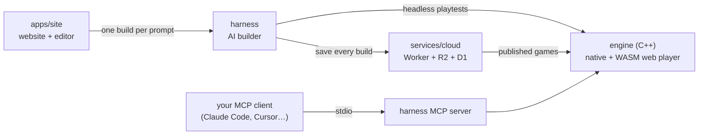

# Dreamsy

An open-source, lightweight engine and AI harness for 2D and 2.5D games. Describe a game, then play it: natively on iOS
and Android, and in any browser.

[DREAMSY.MD](DREAMSY.MD) is the overview and the map of the spec in [`docs/`](docs/) (format, runtime, harness, platform,
kits, engine), the source of truth for architecture and decisions. [STATUS.md](STATUS.md) is the current state.

## How it fits together



Everything speaks one contract: the **game package** defined in `format/` (docs/format.md §3), a folder you can read by
hand, packed into one small `.dpk` file (typically 30–220 KB). The harness writes packages, the engine runs them, and the
cloud stores and publishes them.

## Repository layout

| Path | What |
|---|---|
| `engine/` | The engine: C++20, 2D and 2.5D, one core for web (WASM), iOS, Android and headless tools (`dreamsy-tool`). See [engine/README.md](engine/README.md). |
| `format/` | `@dreamsy/format`: package schemas, entity catalog, validator, edit ops. [LUAU_API.md](format/LUAU_API.md) is the scripting contract. |
| `kits/` | 21 kits: tested Luau libraries for genres (platformer, rpg, farming…) and foundations (core, juice, combat…). |
| `harness/` | `@dreamsy/harness`: the AI builder (router, agent, playtests, art review), the MCP server and the CLI. See [DESIGN.md](harness/DESIGN.md). |
| `apps/site/` | `@dreamsy/site`: the website (landing, library, kits, docs) and the **editor** at `/editor`. Next.js. See [apps/site/README.md](apps/site/README.md). |
| `services/cloud/` | `@dreamsy/cloud`: Cloudflare Worker for saving games without accounts and publishing them. See [services/cloud/README.md](services/cloud/README.md). |
| `games/examples/`, `games/showcase/` | Hand-written golden packages (one per kit) and generated showcase games. `games/mine/` (gitignored) holds your own games. |
| `taste/` | House-style packs and reference images the harness uses for art direction. |
| `docs/` | The spec by topic and the C++ guide for TypeScript developers. |
| `third_party/` | Vendored libraries (Luau, Box2D, sokol…). Don't modify. |

The earlier hosted platform (`services/api`, `services/gameserver`, `apps/web`, `apps/mobile`, `deploy/`, `scripts/dev.sh`)
is still in the repo but not deployed; see [Hosted platform](#hosted-platform).

## Quick start

Needs Node with pnpm (`packageManager: pnpm@10.4.1`), CMake and a C++20 compiler.

```sh
pnpm install

# the engine: dreamsy-tool (validate, pack, run, playtest)
(cd engine && cmake --preset release && cmake --build --preset release)

# optional, for in-browser previews and playtest screenshots: the web player (needs emsdk 4.0.11)
(cd engine && cmake --preset web && cmake --build --preset web --target dreamsy-player)
```

### Make games in the editor

```sh
pnpm -C apps/site dev        # http://127.0.0.1:3100/editor
```

Add your Anthropic or OpenAI key in the editor (kept in an httpOnly cookie, never written to disk), name a game and
describe it. Games are folders in `games/mine`; every build is versioned and can be restored.

### Make games from Claude Code (MCP)

```sh
claude mcp add dreamsy -- npx -y dreamsy-mcp                       # published package (packages/mcp)
claude mcp add dreamsy -- pnpm -s -C /path/to/dreamsy/harness mcp   # from this clone
```

Then ask: “build a cozy frog platformer with dreamsy”. Your own client and model do the building; no Dreamsy key or server
is involved (docs/harness.md §5.4).

### Make games from the command line

```sh
pnpm -C harness local --prompt "a pixel game where a frog collects coins" --out /tmp/frog [--rounds N]
pnpm -C harness local --prompt "make the frog faster" --base /tmp/frog --out /tmp/frog
engine/build/release/dreamsy-tool playtest /tmp/frog        # headless playtest report (JSON)
```

The CLI reads model keys from the repo-root `.env` (`ANTHROPIC_API_KEY`, optional `OPENAI_API_KEY`, `GEMINI_API_KEY`).

## Environment

Real env files are gitignored; only `.env.example` templates are committed.

| Where | Variable | What |
|---|---|---|
| `apps/site` | `DREAMSY_GAMES_DIR` | Where editor games live (default `games/mine`). |
| `apps/site` | `DREAMSY_CLOUD_URL` | The deployed `services/cloud` Worker; when set, every build is also saved to the cloud. |
| `apps/site` | `SITE_URL` | Public URL for canonical links, Open Graph images, `robots.txt` and the sitemap. |
| repo-root `.env` | `ANTHROPIC_API_KEY`, `OPENAI_API_KEY`, `GEMINI_API_KEY` | Keys for the harness CLI (`local`, `worker`). The editor uses the user's own keys instead. |
| `services/cloud/wrangler.toml` | `ALLOWED_ORIGINS` | Site origins allowed to call the Worker from a browser. |

## Common tasks

```sh
pnpm test                                   # every package's tests
pnpm typecheck                              # every package's typecheck

pnpm -C format cli validate /tmp/frog       # validate a game package
pnpm -C format catalog                      # regenerate format/catalog.json
pnpm -C apps/site brand                     # regenerate the OG image and app icons from the logo

pnpm -C services/cloud test                 # Worker tests on local R2 + D1 (Miniflare)
pnpm -C services/cloud migrate:remote       # apply D1 migrations
pnpm -C services/cloud deploy               # deploy the Worker (wrangler login first)
```

Engine builds, tests and conformance checks are in [engine/README.md](engine/README.md).

## Hosted platform

The previous product was a hosted platform: an Expo app and a web studio talking to an API (Hono + Postgres + blobs) that
queued builds for harness workers, plus a multiplayer room server. It was torn down on 2026-11-16 and is not deployed.
`./scripts/dev.sh` still runs the whole stack locally (needs Docker Desktop and Expo Go); `deploy/` keeps the Docker
Compose setup. See `services/api`, `services/gameserver`, `apps/web` and `apps/mobile` for details.

## Conventions

- The game package format is the central contract. Don't change `format/` without updating docs/format.md §3.
- 2D and 2.5D only; the format keeps 3D types, but the engine rejects 3D packages.
- `third_party/` is vendored; don't modify it.
- Per-package details live in each package's own README.

## License

Dreamsy's own code is under the [PolyForm Noncommercial License 1.0.0](LICENSE): free to use, change and share for
personal, hobby, research, educational and nonprofit purposes; commercial use is not permitted. Libraries vendored in
`third_party/` keep their own licenses.
